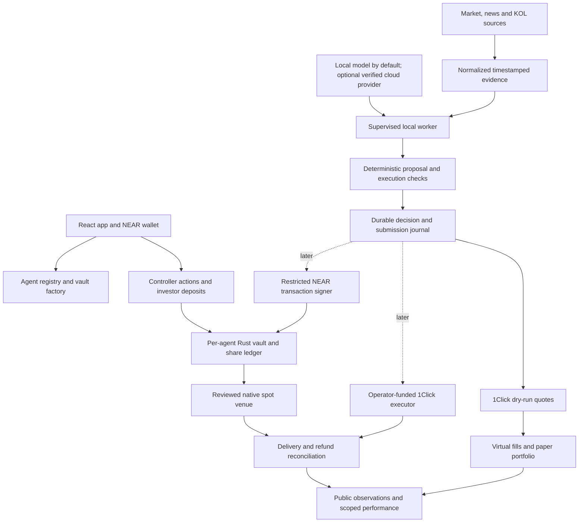

# pump on NEAR: architecture and migration design

Design date: 20 October 2026. Status: proposed architecture, based on source review and the official documentation linked below. **User decision: the demo uses live dry-run quotes and simulated capital; mainnet settlement is deferred until testing and contract review/audit are complete.** Implementation update: the paper-trading workbench and trusted testnet clearing are implemented, and clearing is deployed as `pumpcoin-demo-472db8.testnet`. See the [runbook and verification status](NEAR-DEMO-RUNBOOK.md). The broader production architecture below remains a proposal. Saved Monad observations are historical evidence; no current wallet, private keystore, live deployment, or balance was inspected for this review.

Implementation update, 26 October 2026: isolated keyless agent testnet vaults,
NEP-141 pump coin and the investor frontend are implemented. Returns are
trusted, surplus-backed paper-round assertions. Production custody and actual
settlement remain deferred. See [agent vaults](NEAR-AGENT-VAULTS.md).

## 1. Recommendation

Keep the product's central rule: **the agent proposes trades; a separate execution system controls authority; investor custody enforces its declared mandate.** Keep self-hosted inference as the default.

Build NEAR support in three milestones:

1. **Demo autonomous paper trading using live 1Click dry-run quotes.** A supervised local worker runs the real model, validates a bounded proposal, requests a fresh `dry: true` quote and records an assumed fill in a virtual portfolio. Show positions, trading activity, realized/unrealized P&L, drawdown, blocked decisions and replayable quote evidence. No wallet funding, transaction signer, token transfer or contract deployment is required for this demo. See [the paper-trading specification](NEAR-PAPER-TRADING.md).
2. **Prove actual settlement later with isolated operator capital.** After the relevant implementation is tested and reviewed, use a separately enabled executor to journal authorization before submission and reconcile delivery/refunds. This later milestone establishes actual execution; local signing policy is an operator-custody boundary, not an investor vault guarantee.
3. **Enable investor vaults after custody testing and independent review/audit.** A Rust vault owns NEP-141 assets and per-vault shares. A function-call key permits the worker to call one trade-entry method. The contract checks policy and dispatches a reviewed native spot adapter. Intents trading enters this custody path only after its authorization, recipient, expiry, and settlement guarantees are demonstrated end to end.

The demo does not depend on mainnet settlement, cross-chain custody, confidential hosting or pooled share accounting. Paper portfolios, later operator-funded execution and investor-vault performance have separate readiness states and histories. Quote-based P&L is hypothetical and must never be relabeled as settled returns.

**Recommended initial investor-vault market:** a reviewed NEAR stablecoin / wNEAR pair, quote-token deposits and redemptions, no leverage. Exact token accounts, venue, pool, oracle and liquidity are deployment inputs to verify before implementation commits to a market. A symbol such as USDC is insufficient to identify an asset.

## 2. What the current project does

The NEAR demo uses the React/Vite frontend in `app/`, the local TypeScript
service in `near-demo/`, and the Rust contracts in `contracts-near/`.
The earlier Monad prototype established the local inference and restricted
execution design. The NEAR integration uses its own wallet authorization,
evidence and accounting.

- The local model proposes HOLD, BUY or SELL. Pump checks the saved strategy,
  trade bounds and quote before recording a simulated fill.
- NEAR Intents 1Click provides signed dry-run quotes for the paper portfolio.
  The quote and decision journal can be exported and replayed.
- Each published strategy version has an isolated NEAR testnet vault. Circle
  test USDC deposits and redemptions settle on testnet, while a trusted
  reporter updates vault NAV from the paper portfolio.

## 3. How the NEAR tools fit

| Tool | Use in pump | Boundary |
| --- | --- | --- |
| Named accounts and subaccounts | Readable controller, worker, registry and per-agent vault identities | Names organize accounts; contract authorization still has to define control |
| Function-call keys | Restrict a vault worker to a particular contract/method, with a finite gas allowance | Not a token-spend cap, argument validator or expiring trading mandate; cannot attach NEAR |
| NEAR Intents / 1Click | Live dry-run quotes for the paper demo; later real swaps, cross-chain onboarding and a separately reviewed vault route | Quotes are not fills; later settlement has solver/API/bridge dependencies; no Intents testnet |
| Chain Signatures | Later policy-controlled direct execution on foreign chains when Intents cannot express the operation | Produces signatures; foreign-chain broadcast, gas, nonces, receipts and asset accounting remain our responsibility |
| Meta transactions | Optional sponsored onboarding and selected controller/investor actions | Requires a funded relayer with its own abuse and spending controls; sponsorship grants no trading authority |
| NEAR AI Cloud / TEEs | Optional separately selected inference provider with verified evidence | Does not automatically attest the local model, signer, research sources or entire trading strategy |
| NEAR APIs and Rust SDK | TypeScript account/RPC/transaction client and Rust/WASM custody contracts | Pin versions during implementation and test the selected wallet/client combination |

Sources: [account model](https://docs.near.org/protocol/accounts-contracts/account-model), [access keys](https://docs.near.org/protocol/accounts-contracts/access-keys), [1Click flow](https://docs.near-intents.org/integration/distribution-channels/1click-api/quickstart/making-a-request), [Intents FAQ](https://docs.near-intents.org/resources/faqs), [Chain Signatures](https://docs.near.org/chain-abstraction/chain-signatures), [transaction signing](https://docs.near.org/chain-abstraction/chain-signatures/implementation), [meta transactions](https://docs.near.org/protocol/transactions/meta-tx), [NEAR AI models](https://docs.near.ai/cloud/models), [API libraries](https://docs.near.org/tools/near-api).

### Three distinctions that prevent an unsafe shortcut

**A NEAR access key and an Intents account key are different authorities.** The Verifier maintains its own keys; its documentation states those keys have full account control, including key management. Do not register the ordinary worker key as a key controlling pooled investor balances in Intents and call it restricted merely because its NEAR transaction key has a function-call permission. [Verifier account abstraction](https://docs.near-intents.org/integration/verifier-contract/account-abstraction).

**1Click execution is asynchronous.** The standard route requests a quote, transfers to a deposit address, then tracks settlement or refund. A valid quote signature establishes API origin/integrity; it does not establish a fair NAV, a guaranteed fill or a pump policy check. Signed-intent execution is a distinct flow for balances already in Intents. [Quote signatures](https://docs.near-intents.org/integration/distribution-channels/1click-api/verify-quote-signature), [signed-intent execution](https://docs.near-intents.org/integration/distribution-channels/1click-api/quickstart/signed-intent-execution).

**Cross-contract execution is not an EVM atomic transaction.** An earlier transfer may survive a later failed callback. The existing `managerTrade` postcondition/revert behavior cannot be copied into asynchronous callbacks and retain the same guarantee. [Cross-contract calls](https://docs.near.org/smart-contracts/anatomy/crosscontract).

## 4. Target system



The active demo path stops at the paper portfolio and reports. Custody, signer and settlement boxes are future work. These are logical modules, not a requirement to deploy a service for every box. Keep one supervised local worker and a small backend initially. The browser is a control/review surface; it is not the scheduler. A sleeping/offline operator host still stops local inference and new trade decisions.

### Accounts and custody (future funded modes)

Illustrative names below are placeholders, not allocated accounts:

| Account | Purpose | Key policy |
| --- | --- | --- |
| Controller wallet | Owns agent registration; proposes policy; pauses/revokes | Human-controlled recovery/full-access authority |
| `registry.<project>.near` | Versioned agent records and deployment references | Governance policy independent of worker |
| `<agent>.vaults.<project>.near` | Investor capital, share accounting and mandate | No worker-held full-access key; preferably no account access keys after factory initialization |
| `<agent>.workers.<project>.near` | Signs restricted trade requests; holds small gas balance | Local execution key is function-call-only; controller retains recovery authority on this worker account |
| Separate operator trial account | First 1Click execution proof | Locally controlled signing with explicitly bounded operator capital; never pooled investor custody |

The vault factory creates/deploys/initializes each vault without leaving an operator deployment key that could bypass its code. The initial funded version should be immutable with no generic upgrade/sweep/call method. Upgrades use a new reviewed vault and explicit investor migration; a later upgrade mechanism needs its own disclosed governance design. Account-name hierarchy is not a substitute for contract ownership checks.

Example worker access permission:

```json
{
  "receiver_id": "<agent>.vaults.<project>.near",
  "method_names": ["submit_trade"],
  "allowance": "<finite gas allowance in yoctoNEAR>"
}
```

`submit_trade` accepts zero attached NEAR. It authorizes the direct worker predecessor, verifies the expected signer account/public key for this direct-call path, and checks the current on-chain grant. The vault pays the required outgoing one-yocto attachments from its separately accounted operational reserve. Worker keys cannot directly call token transfer methods or arbitrary venues. Controller/investor methods use separate authorization and deposit-capable wallet calls. [One-yocto requirements](https://docs.near.org/smart-contracts/security/one_yocto).

The contract grant binds worker account/key, manifest, config version, pair/venue, expiry, trade cap, daily gross turnover, output protection and exposure policy. Revocation remains available when paused or pricing is unavailable. Key deletion and grant revocation are complementary controls. Neither can reverse a trade already dispatched.

### Research to execution

Extract a common evidence-to-proposal interface from `research/`; do not execute virtual practice orders as real orders. A funded inference request includes the approved source evidence, observation times, final chain state, holdings, current mandate and supported market IDs. Provider text remains untrusted data.

The model returns a bounded structured proposal, for example `HOLD`, or a side, approved market ID, quote budget and evidence references. It never selects a recipient, arbitrary contract/method, attached deposit, raw transaction or key. Deterministic code validates references, freshness, balances, grant and route before creating an execution plan.

Run inference first against an anchored context, then fetch a fresh executable quote and current state. Revalidate that the proposal still fits its evidence horizon and portfolio. If material state or price changed, discard the decision or reinfer. Do not bypass stale-evidence checks by merely replacing its timestamp. Persist HOLD and blocked outcomes as well as submitted trades.

### Paper-trading executor (current demo target)

Expose only supported-token discovery and dry-run quotes through the demo adapter. Enforce `dry: true` server-side, omit transaction signing/broadcast modules from its execution path, and reject funded actions in paper mode. Feed fresh quote amounts into a separate virtual fill ledger after the local model and deterministic guards approve an order. Use explicit asset IDs/decimals, timestamped order-size quotes, a fixed execution-delay policy and deterministic replay. Display hypothetical P&L and missing/stale valuation honestly. The existing `practice/ledger.ts` offers useful portfolio and replay structure, but its scalar-price/fee model needs an order-size quote fill path. [Detailed specification](NEAR-PAPER-TRADING.md), [1Click dry-run behavior](https://docs.near-intents.org/api-reference/oneclick/request-a-swap-quote).

### Operator-funded 1Click executor (deferred)

Use `@defuse-protocol/one-click-sdk-typescript` behind a server-side adapter. Start with the standard origin-chain deposit flow and supported assets returning to the same controlled NEAR account. Discover actual asset IDs, decimals, minimum sizes, fees and quote availability from the API; choose a pair only after checking it.

The deterministic executor fixes recipient/refund account to the trial account, validates signed quote fields, exact amount and slippage/deadline, and persists the full request/response and planned transfer. Only then does the separate local signer authorize the narrowly constructed transfer. It stores exact signed bytes/hash before broadcast.

Track the deposit address, optional memo, submission hash, quoted assets, actual delivery/refund and fees. API status is an observation; reconcile relevant chain movements before labeling the operation settled. `FAILED` or a timeout alone is not proof funds returned. Never send a second deposit to resolve uncertainty.

The trial signer may need deposit-capable/full-access authority on its small isolated account. A function-call key cannot directly perform an FT transfer requiring one yocto. Therefore this mode has local policy enforcement and operator custody; it is never presented as the funded vault's on-chain mandate.

Intents currently documents no testnet deployment. This does not prevent the paper demo from querying its production API with `dry: true`. Test future contract/executor behavior in fixtures/Sandbox; proving actual Intents settlement later requires a separately provisioned mainnet account, real assets and explicit spend limits. No funded account or run is required for the paper demo. [Intents FAQ](https://docs.near-intents.org/resources/faqs).

### Investor-vault execution (deferred)

Prefer a narrow native spot venue adapter first. Rhea/Ref's documented deposit, quote, swap, internal-balance and withdrawal interfaces are a candidate to investigate. A current aggregator is not interchangeable with that direct exchange interface; route selection must consider gas remaining for vault entry, dispatch and callbacks. No deployed contract, pool, ABI or current liquidity has yet been verified here. [Rhea trading interface](https://guide.rhea.finance/developers-1), [aggregator integration](https://github.com/rhea-finance/rhea-sdk-docs/blob/main/SmartRouterV2%28Aggregated%20DEX%29.md).

One trade in flight per vault initially. The contract records an operation ID, decision commitment, config/grant version, amounts and reserved budgets before emitting outgoing promises. All recipients are fixed by the adapter. Settlement and refund methods are private callbacks; cross-contract token reception checks the actual FT predecessor, sender and operation context. A transfer-call resolver's return value measures input spent, not swap output. Output and any exchange-held balance need separate reconciliation. [Private callbacks](https://docs.near.org/smart-contracts/security/cross-contract-calls/callbacks), [FT transfer-call handling](https://docs.near.org/smart-contracts/security/cross-contract-calls/ft-transfer-call).

Durable operation states:

```text
prepared -> reserved -> dispatched -> settling -> settled
                                      |          
                                      +-> refund_pending -> refunded
                                      +-> recovery_required
```

A timeout cannot clear reserved funds or turn a previously dispatched trade into a new trade. Callbacks must tolerate duplicates/stale operation IDs, and failed callbacks must leave a recoverable record. Pause/revoke blocks new dispatches while permitting safe reconciliation of existing operations. Restrict config activation and share-price-sensitive operations while settlement is unresolved.

**Exposure semantics require an explicit venue feasibility gate.** The EVM vault atomically rejects a fill that violates its post-trade marked exposure. A NEAR callback cannot roll back a completed external swap. Before investor enablement, prove a bounded-fill/venue-side enforcement design, or adopt and disclose a different pre-trade allocation cap with post-fill monitoring and blocked further buys. A minimum-output floor alone does not cap acquired inventory. Until that decision and its tests are complete, do not claim equivalent exposure enforcement or enable investor deposits.

An Intents vault adapter is a later integration, not a wrapper around the trial signer. It must demonstrate contract-enforced destination/refund binding, permission accounting through delayed settlement, and an authorization route that never gives the ordinary worker unrestricted Intents custody. Contract-controlled MPC signing could be investigated, but is not assumed to be a drop-in feature of 1Click.

## 5. Assets, valuation and shares

- Use explicit token contract/asset IDs and pinned decimals; wNEAR uses 24 decimals. All amounts are integer strings/BigInt off-chain and checked integer arithmetic on-chain. Replace the current `1e18` position-price convention with a versioned price representation and explicit rounding rules.
- Start with one quote and one position token. Investor deposits arrive through the quote token's `ft_transfer_call`; verify the token predecessor and credit `sender_id`, not an arbitrary message-supplied depositor. Reject/refund deposits when admission checks fail.
- NEAR cross-contract reads are asynchronous too. A vault cannot synchronously read another oracle like the Solidity vault. Use a reviewed oracle-query/callback flow that validates and caches a timestamped local valuation checkpoint, or a verified signed-price design. Pin the source and check publication freshness/quote conversion before using the local checkpoint.
- Select and prove that valuation source before funded-vault implementation is considered ready. A swap quote or a DEX spot price alone is not independent share valuation. Separate execution slippage, source freshness/confidence and share-price admission policies. Stablecoins are not automatically one dollar.
- Preserve cashflow-adjusted P&L and configuration-specific records. Migrate mathematical concepts from `vault/nav.ts`; rewrite its scaling and EVM-bound types. Rewrite event replay rather than transplanting assumptions about adjacent ERC-20 logs in one transaction.
- Each vault has its own NEP-141 share ledger and metadata/storage interface. There is no ERC-4626 claim. Define initial issuance, rounding, donation handling, insolvency and minimum-deposit rules explicitly.
- Register vaults/investors on the required token/share contracts before transfers; budget storage separately from gas and trading capital. [FT and storage standards](https://docs.near.org/primitives/ft/standard).
- Keep pending trade assets distinct from spendable balances. Initially block new share issuance/redemption settlement while any capital operation is unresolved; incoming transfer-call deposits return unused amounts. Native NEAR donations and operational reserves do not mint shares.
- Redemption reserves shares/cash before the outgoing token call, then finalizes the burn or restores the reservation on verified failure. Synchronous EVM redemption semantics do not carry over. No automatic forced liquidation or immediate-liquidity promise.
- Budget worker gas, vault storage/attachments and oracle costs separately. Funding operational reserves is not trading profit. Reject new dispatch before reserves are exhausted; already dispatched operations remain recoverable.

## 6. Identity, evidence, inference and frontend

**Identity:** Use a small native registry mapping a stable agent ID to controller, worker, vault, manifest digest, evidence URI and versions. An NFT is optional. ERC-8004 is an existing EVM integration, not a required NEAR identity primitive. Controller authorizations use a domain-separated NEP-413 challenge plus account-key ownership/authority checks at an anchored state; a valid signature alone must not grant admin authority. [NEAR backend authentication](https://docs.near.org/web3-apps/backend/backend).

**Versioning:** Define `PUMPCOIN-NEAR-MANIFEST-v2` and new decision/receipt formats. Include network namespace, account IDs, signing scheme, hash/encoding version, manifest/policy versions and operation IDs. Choose a deterministic cross-language encoding and SHA-256 digest for new records, verified by TypeScript/Rust test vectors. Retain old keccak/EIP-191 records unchanged and verify them with their historical verifier.

**Reconciliation:** Maintain per-access-key nonces and recent-block-hash validity; journal signed bytes before submission. After a timeout, query/rebroadcast the same valid transaction and consult on-chain operation IDs. After validity expiry, prove the operation did not execute before authorizing a replacement. Require receipt execution and finality, not an EVM-style count of two confirmations. Record final receipt outcomes, token movements, config versions, refunds and callback state. A successful parent transaction alone is not sufficient evidence. [Transaction lifecycle](https://docs.near.org/protocol/transactions/transaction-execution).

**Inference:** `local` remains the default provider, retaining artifact measurement and loopback restrictions. `near-ai-cloud` is an explicit alternative with a new signed provider/model policy and server-only credentials. Do not broaden loopback validation globally or silently fall back to hosted inference. NEAR AI offers an OpenAI-compatible API, but the current catalog distinguishes own-fleet TEE, third-party TEE and Incognito upstream models. Verify the selected provider's actual evidence and bind request/response digests before labeling an inference attested. This does not attest execution signing or profitability. [Cloud API](https://docs.near.ai/cloud/quickstart), [privacy tiers](https://docs.near.ai/cloud/models), [verification](https://docs.near.ai/cloud/verification).

**Frontend:** Keep registration, directory, agent profile, research and evidence views. Replace Mera/EIP-1193 transaction paths with a tested NEAR wallet connector and NEAR actions. NEAR Connect is the initial connector candidate. Display account ID/network and distinguish registration, grant active, worker online, proposal blocked, transaction included, swap settling, refunded and reconciled. Hosted pages cannot infer the local worker is online from a permission alone. [NEAR Connect](https://docs.near.org/tools/near-connect).

**Hosting:** Extract operator services from Vite-only lifecycle into a standalone loopback daemon/CLI; Vite can proxy it during development. Keep keys, private inference and source credentials there. Public hosting reads published records and chain observations. Authenticated, time-limited heartbeat publication can report worker observations later, with explicit stale/offline status and no remote generic signing endpoint.

**Optional later capabilities:** Meta-transaction sponsorship comes after direct execution works. Relayer budgets/rate limits must be separate because function-call key gas allowances are not charged when a relayer pays. Chain Signatures comes after a concrete foreign-chain execution need; a policy contract must construct and validate the exact permitted signing payload rather than expose arbitrary-hash signing. Foreign-chain holdings require their own reconciled accounting before inclusion in investor NAV.

## 7. Repository layout

```text
app/              React interface and NEAR wallet integration
near-demo/        Local inference, signed quotes, paper trading, and vault reporting
contracts-near/   Rust clearing, strategy vault, vault factory, and test token
deployments/      NEAR testnet deployment configuration
staging/verifier/ Independent verification of public strategy evidence
tests/            NEAR integration and local artifact checks
```

These directories are proposed, not created. Avoid building a general multi-chain framework. Add narrow typed interfaces for the selected NEAR implementation; retain EVM verification for historical records. A chain reference must include its namespace/network, not reuse numeric `chainId` with a fake EVM number for NEAR.

## 8. Migration sequence and acceptance

| Stage | Concrete work | Exit evidence |
| --- | --- | --- |
| 0. Quote feasibility | Read-only 1Click asset/quote discovery; measure local-model latency; select approved demo market IDs | Valid dry-run quotes, exact decimals and visible quote age; no signing dependency |
| 1. Paper foundations | Quote adapter forced to dry mode, virtual capital ledger, recorded fill/cost policy and append-only journal | Reproducible balance/P&L arithmetic, failed/stale quote handling and restart safety |
| 2. Paper demo | Wire real local research/inference to simulated buy/sell/HOLD; show portfolio, trade history and hypothetical P&L | Genuine model decisions and recorded quote-backed assumed fills; visible simulation labels; no transfer/sign/broadcast path reachable |
| 2b. Deferred funded proof | After testing/review, implement NEAR key/account types, transaction journal and separately enabled live executor | Real model-driven buy/sell, approved bounded spend, final receipt/delivery reconciliation and restart recovery |
| 3. Guarded native custody | Rust factory/registry/vault, restricted worker, chosen spot adapter and valuation, explicit async exposure semantics | Sandbox transfer/refund/callback tests; reviewed deployment/authority design; no ordinary worker-controlled investor capital |
| 4. Investor accounting | Share issuance/redemption, storage registration, reserves, NAV and receipt replay | Deposit, model-driven buy/sell, redemption and cashflow reconciliation; callback failures and concurrent-operation tests |
| 5. Product cutover | NEAR wallet UI, daemon controls, live readiness and hosted records; fresh performance baselines | Desktop/mobile workflow, stale/offline states, no Monad transaction path active in NEAR mode |
| 6. Optional expansion | Cross-chain funding, policy-enforced Intents custody, sponsorship, cloud inference or foreign-chain signing | Separate capability-specific acceptance, not inferred from a native swap |

Stage 2 requires actual model inference and recorded hypothetical fill evidence; actual settlement is not required. HOLD is valid; do not force model trades for a demo. A separately labeled historical replay or scripted scenario can illustrate activity if live decisions remain HOLD, but must not be presented as fresh autonomous decisions. Stage 2b is a separate future objective and needs the intended account/spend limits configured before broadcast. Paper success does not satisfy funded-custody acceptance.

For the native vault, test at least unauthorized key/method, grant expiry/revocation/rotation, daily turnover across restarts/day boundaries, stale valuation, 24/6 decimal conversion, price changes during inference, concurrent deposits, duplicate callbacks, failed token transfer, partial refund, callback out-of-gas, missing storage registration, stale config, unknown transaction and successful parent/failed child receipt. Test the declared exposure guarantee at the actual venue boundary.

No automatic investor or token migration: NEAR registrations and funded performance start fresh, with explicit links to prior identities/history. Existing Monad balances and shares remain claims on their original contracts until an independently designed redemption/migration flow is authorized and implemented.

## 9. Current result and remaining decisions

This review produces an implementation direction and acceptance plan, not a claim of operational NEAR trading. The existing root TypeScript check passed during review. No runtime code, dependencies, signing keys, wallet permissions or deployments were changed.

The immediate objective is a quote-driven paper demo with no token movements. Funded execution is deferred until testing and review/audit readiness. Before enabling a funded mode, resolve the actual account/asset/spend configuration; before investor custody, verify the native venue, independent price source, contract gas envelope, settlement recovery and exposure semantics. Paper performance remains distinct from settled or investor returns.
